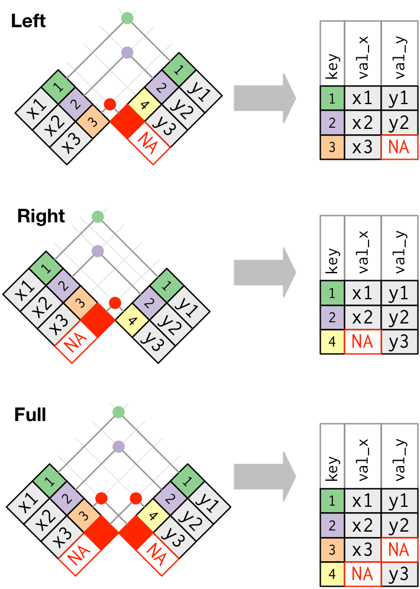

```{=html}
<style>
.h1,h2,h3 {
color:#2f1a61;
}

.subtitle, section.normal {
color:#291854;
}

.title {
color:#cc0065;
}

.nav-pills>li>a{
color: #2f1a61;
}

.nav-pills>li.active>a, .nav-pills>li.active>a:hover, .nav-pills>li.active>a:focus {
color: #fff;
background-color: #2f1a61;
}

.nav-tabs>li>a{
color: #2f1a61;
}

.nav-tabs>li.active>a, .nav-tabs>li.active>a:hover, .nav-tabs>li.active>a:focus {
color: #fff;
background-color: #2f1a61;
}

</style>
```

```{r setup, include=FALSE}
knitr::opts_chunk$set(echo = TRUE, message = FALSE, warning = FALSE)
pacman::p_load(tidyverse, purrr, dp)
```

# Introduction

Many "big data" problems are actually "small data problems in disguise". That is, we only really need a subset of the data, or maybe we want to aggregate the data into some larger dataset. For example, we might want to access Census data, but only for a handful of municipalities. Or, we might want to analyse climate data collected from a large number of weather stations, but aggregated up to the national or monthly level. In such cases, the underlying bottleneck is interacting with the original data, which is too big to fit into memory. How do we store data of this magnitude and and then access it effectively? The answer is through a database.

Databases can exist either locally or remotely, as well as in-memory or on-disk. Regardless of where a database is located, the key point is that information is stored in a way that allows for very quick extraction and/or aggregation. More often than not, you will probably need to extract several subsets and harmonize or transform them. To facilitate and automate this task, you will need to write your own functions and know to iterate them over the relevant subsets of data. This week's session thus ties in well with the sections on functions and iteration that we quickly touched upon during the last lab.

------------------------------------------------------------------------

# Joins and Databases 🔭

Although this week's session is nominally about databases - and we will spend the majority of this session on them - we believe that joins in R are a key skill. Therefore, we will split the session in two. First we will cover joins as implemented by the tidyverse. In that section you will learn to:

- join different datasets
- differentiate between types of joins

The second part of the session will deal with databases and SQL. Here you will learn to:

- connect to remote databases with R
- generate SQL queries in R with `dbplyr`
- manipulate and transform data in a remote database
- collect hosted data and store it locally

------------------------------------------------------------------------

# Joins with `dplyr`

Why would you want to combine two (or more) tables?

The information you need is often spread across tables. For example, a flight record may contain an airline code, while another table stores the airline's name. The `dplyr` package provides [join operations](https://cran.r-project.org/web/packages/dplyr/vignettes/two-table.html) to add information or filter rows by matching values across tables:

- `dplyr::inner_join(df1, df2)`
- `dplyr::left_join(df1, df2)`
- `dplyr::right_join(df1, df2)`
- `dplyr::full_join(df1, df2)`
- `dplyr::semi_join(df1, df2)`
- `dplyr::anti_join(df1, df2)`

The diagram below shows which rows each join keeps.

[](https://r4ds.had.co.nz/relational-data.html)


------------------------------------------------------------------------

We will use two tables from [**nycflights13**](http://github.com/hadley/nycflights13) to illustrate how to perform joins. `flights` contains flight records, and `planes` contains aircraft details. Both have a `tailnum` column identifying the aircraft. We can use it to add aircraft details to each flight.

```{r, echo = F}
library(nycflights13)
glimpse(flights)
glimpse(planes)
```

Use `left_join()` to keep every flight and add matching aircraft details. Set `by = "tailnum"` to specify the column used to match rows (join key).

With joins, you have to be careful with shared column names. `year` means flight year in `flights` but construction year in `planes`. Without `by`, `dplyr` would match on both `tailnum` and `year`. We specify `tailnum` and rename the aircraft's `year` to `year_built`:

```{r}
flights |>
  dplyr::left_join(
    planes |> dplyr::rename(year_built = year),
    by = "tailnum"
  ) |>
  dplyr::select(year, flight, tailnum, year_built, type, model) |>
  head(3)
```


What happens if we keep `by = "tailnum"` but do not rename `year`? Try modifying the code above and see for yourself.

------------------------------------------------------------------------

::: {.alert-info .pad-box}
**Exercise 1** 🏋

a)  Use the `airlines` table to add airline names to `flights`. Inspect the tables to identify the matching columns and choose the appropriate join.

b)  Find flights made with planes that **aren't in the `planes` registry**. Then identify which airline has the most of these flights. Use the `airlines` table to include the airline's name in your answer.

:::

```{r}

```


------------------------------------------------------------------------

# Working with databases 💾

So far, we have dealt with small datasets that easily fit into your computer's memory. But what about datasets when we work with data that are **too large** for our computers to handle as a whole?

In this case, storing the data outside of R and **organizing it in a database is helpful**. Connecting to the database allows you to retrieve only the parts needed for your current analysis.

------------------------------------------------------------------------

## Necessary packages

Accessing databases in R requires a few packages:

- `dbplyr` is the database backend for `dplyr`. It makes use of the `dplyr`, but works with remote data stored in databases.

- `DBI` is a package that allows R to connect easily to a DBMS (**D**ata**B**ase **M**anagement **S**ystem)

- Some package to interact with the back-end of the remote database such as `RSQLite`, other options might be:

  - `RMariaDB::MariaDB()` for RMariaDB,
  - `RPostgres::Postgres()` for RPostgres,
  - `odbc::odbc()` for odbc,
  - `mongolite::mongo` for MongoDB,
  - and `bigrquery::bigquery()` for BigQuery.

```{r, include=FALSE}
pacman::p_load(RSQLite, DBI, bigrquery, dbplyr) # getting packages we might need
```

------------------------------------------------------------------------

## Connecting to a database

To connect to the database, we will use `DBI::dbConnect()` from the `DBI` package which defines a common interface between R and database management systems. The **first argument** is the **database driver** which in our case is SQLite and the **second argument** is the **name and location of the database**.

Most existing databases don't live in a file, but instead live on a server. In addition to the two arguments above, database drivers will therefore also require details like user, password, host, port, etc. That means your code will often look more like this:

``` r
con <- DBI::dbConnect(RSQLite::SQLite(),  # driver
  host = "database.rstudio.com",
  user = "your_username",
  password = rstudioapi::askForPassword("Your password")
)
```

------------------------------------------------------------------------

For the purposes of this lab however, we are connecting to an **in-memory database**. That way we can avoid potential issues with the registration for access to a database, creation and caching of credentials, as well as defining safe ports and other boring details.

To avoid all this hassle, we will create and host our own (small) database in our local memory. Luckily, the code to do so is **the same as in the general case above**. But, SQLite only needs a path to the database. (Here, `":memory:"` is a special path that creates an in-memory database.)

We then **save** the database connection and store it in the object `con` for further use in exploring and querying data.

```{r}
# set up connection with DBI and RSQLite
con <- DBI::dbConnect(RSQLite::SQLite(), ":memory:")
```

Next, let us get a quick summary of the database connection using `summary()`. It shows **"SQLiteConnection" under class** and we can ignore the other details for the time being. Great!

```{r}
summary(con)
```

If you were to connect to a real online database that someone else generated, you could now call `DBI::dbListTables(con)` to see a list of the tables present in the database. Our local database is however still devoid of content.

**We need to populate our database**. We will copy some data from `nycflights13` to our database connection. In **real life**, this step would probably be taken care of by the responsible **database maintainer**.

```{r}
# upload local data frame into remote data source; here: database
dplyr::copy_to(
  dest = con, 
  df = nycflights13::flights, 
  name = "flights"
)
```

------------------------------------------------------------------------

## Indexing

Unfortunately, it is not enough to just copy data to our database. We also need to pass a list of **indexes** to the function. In this example, we set up indexes that will allow us to **quickly process the data by** time, carrier, plane, and destination. Creating the right indices is key to good database performance. Again, in applications where we don't set up the database, this will be taken care of by the database maintainer.

```{r}
dplyr::copy_to(
  dest = con, 
  df = nycflights13::flights, 
  name = "flights",
  temporary = FALSE, 
  indexes = list(
    c("year", "month", "day"), 
    "carrier", 
    "tailnum",
    "dest"
  ),
  overwrite = T # if set to FALSE and the table already exists (as it is the case now), it will prevent this from overwriting performing the changes
)
```

------------------------------------------------------------------------

## List Existing Tables in a Database

Now that we are connected to a database, let us list all the tables present in it using `DBI::dbListTables()`.

```{r}
DBI::dbListTables(con)
```

As you can see there is only one table for now (flights). The other objects that show up are infrastructure specificities for SQLite that you can safely ignore. Usually you would **find many different tables** in a relational database.

------------------------------------------------------------------------

# Queries

A query is a request for data or information from a database table or combination of tables. 📖

## Reference Table

So how do you query a table in a database?

It is actually fairly straightforward. You use the `dplyr::tbl()`function where you indicate the **connection** and the **name of the table** you want to interact with.

```{r}
# generate reference table from the database
flights_db <- dplyr::tbl(con, "flights")
flights_db 

## You will notice that there are some slight differences from our <tibble> or <data.frame> types (see "Source:" and "Database:")
```

The console output shows that this is a **remote source**; the table is not stored in our RStudio environment. Nor should you need to transfer the entire table to your RStudio environment. You can perform operations directly on the remote source. What is more, you can rely on the `dplyr` syntax to formulate your queries. R will automatically translate it into SQL (more on that below).

------------------------------------------------------------------------

## Selecting Columns

You can select specific columns:

```{r}
# perform various queries
flights_db |> dplyr::select(year:day, dep_delay, arr_delay)
```

------------------------------------------------------------------------

## Filtering by Rows

Access only specific rows:

```{r}
flights_db |> dplyr::filter(dep_delay > 240)
```

------------------------------------------------------------------------

## Summary Statisitics

Or immediately generate summary statistics for different groups:

```{r}
flights_db |> 
  dplyr::group_by(dest) |>
  dplyr::summarize(delay = mean(dep_time))
```

------------------------------------------------------------------------

## More advanced operations

You can even generate and plot figures without the need to store the data in your local environment:

```{r,echo=TRUE, results='hide', fig.keep='all'}
flights_db |> 
  dplyr::filter(distance > 75) |>
  dplyr::group_by(origin, hour) |>
  dplyr::summarize(delay = mean(dep_delay, na.rm = TRUE)) |>
  ggplot(aes(hour, delay, color = origin)) + 
  geom_line() 
```

------------------------------------------------------------------------

## Joins

Databases become more exciting with more tables. So let's add a couple more:

```{r}
dplyr::copy_to(
  dest = con, 
  df = nycflights13::planes, 
  name = "planes", # we create the "planes" table
  temporary = FALSE, 
  indexes = "tailnum"
)

dplyr::copy_to(
  dest = con, 
  df = nycflights13::airlines, 
  name = "airlines", # we create the "airlines" table
  temporary = FALSE, 
  indexes = "carrier" 
)

dplyr::copy_to(
  dest = con, 
  df = nycflights13::weather, 
  name = "weather", # we create the "weather" table
  temporary = FALSE, 
  indexes = list(
    c("year", "month", "day", "hour", "origin")
  )
)
```

::: {.alert-info .pad-box}
**Exercise 2** 🏋

Now it's your turn! Let's now add the `airports` table to our database.

**Your task:**

a)  Inspect the `nycflights13::airports` dataset (use `head()`, `glimpse()`, or `View()`). Which column uniquely identifies each airport?

b)  Add the `airports` table to the database with the appropriate index.
:::

```{r}

```

Now let us call `DBI::dbListTables()` again on our "con" database connection. As you can see, there are several more tables now.

```{r}
DBI::dbListTables(con)
```

------------------------------------------------------------------------

## Working with joins

The `join` syntax has its origin in SQL. Unsurprisingly, you can join tables without having to store the data in memory. Here is how you perform a left join:

```{r}
planes_db <-  dplyr::tbl(con, 'planes')

dplyr::left_join(
  flights_db,
  planes_db |> dplyr::rename(year_built = year), # taking care of name ambiguity
  by = "tailnum" ## Important: Be specific about the joining column
) |>
  dplyr::select(year, month, day, dep_time, arr_time, carrier, flight, tailnum,
         year_built, type, model) 
```

This should all feel very **familiar** right? 😁

------------------------------------------------------------------------

# A look under the Hood

As you saw, you can conduct your analyses in a database, the same way you are **used to** do it in R. All that without your data having to be stored on your own device.

Unfortunately, there are however **some differences** between **ordinary data frames and remote database queries** that are worth pointing out.

The most important among these is that your R code is translated into SQL and executed in the database on the remote server, not in R on your local machine.

This has the following implications. When working with databases, `dplyr` tries to be as **lazy as possible** 😴:

- It never pulls data into R unless you explicitly ask for it.
- It delays doing any work until the last possible moment: it collects everything you want to do and then sends it to the database in one step.

This even applies when you assign the output of a database query to an object:

```{r, warning=TRUE}
tailnum_delay_db <- flights_db |> 
  dplyr::group_by(tailnum) |>
  dplyr::summarize(
    delay = mean(arr_delay),
    n = n()
  ) |> 
  dplyr::arrange(desc(delay)) |>
  dplyr::filter(n > 100)
```

This leads to some **unexpected behavior**:

**Exhibit A:** Because there's generally no way to determine how many rows a query will return unless you actually run it, `nrow()` is always `NA`.

```{r}
nrow(tailnum_delay_db)
```

**Exhibit B:** Because you can't find the last few rows without executing the whole query, you can't use `tail()`.

```{r, error=TRUE}
tail(tailnum_delay_db)
```

------------------------------------------------------------------------

## Inspecting queries

We can always inspect the SQL code that `dbplyr` is generating in the background:

```{r}
tailnum_delay_db |> dplyr::show_query()
```

That's probably not how you would write the SQL yourself, but it works.

More information about SQL translation can be found here: `vignette("translation-verb")`.

------------------------------------------------------------------------

## From remote to local storage

If you then want to pull the data into a local data frame, use `dplyr::collect()`:

```{r}
tailnum_delay <- tailnum_delay_db |> dplyr::collect()
tailnum_delay
```

------------------------------------------------------------------------

::: {.alert-info .pad-box}
\*\* Exercise 3\*\* 🏋

You want to find the full airline names (not just the carrier codes) for all flights on January 1st.

**Your task:**

a)  Join `flights_db` with `airlines_db` and filter for flights on January 1st. Select the carrier code, airline name, and flight number.

b)  Collect the results into a local dataframe.
:::

```{r}

```

------------------------------------------------------------------------

## Using SQL directly in R

If, for whatever reason you might want to write your SQL queries yourself, you can use `DBI::dbGetQuery()` to run SQL queries in R scripts:

```{r}
sql_query <- "SELECT * FROM flights WHERE dep_delay > 240.0 LIMIT 5"
DBI::dbGetQuery(con, sql_query)
```

If you want to learn more about writing SQL with `dbplyr`, check out `vignette('sql', package = 'dbplyr')`.

------------------------------------------------------------------------

## Disconnect from database

When you are done with your SQL queries, it is a good idea to disconnect from the database. This becomes increasingly important if you work with servers that charge you for their services!

```{r}
DBI::dbDisconnect(con)
```

------------------------------------------------------------------------

## Exercises on Databases

If you want to practice accessing databases going forward, have a look at the practice script [here](https://github.com/intro-to-data-science-25/labs/tree/main/practice-scripts/06_database_example). It comes with a database file so you can open the connection locally without the need to register. You will get a practice script, as well as an answer sheet. You can thank our colleague [Will Lowe](https://conjugateprior.org/) for the excellent example!

------------------------------------------------------------------------

<b style="color:#2f1a61">Acknowledgements</b> {.unnumbered}

The section on databases and SQL relies on the vignette from the [*dbplyr package*](https://cran.r-project.org/web/packages/dbplyr/vignettes/dbplyr.html), [*RStudio Tutorial on databases*](https://db.rstudio.com/getting-started/connect-to-database) as well as the [*Databases Session*](https://github.com/uo-ec607/lectures/blob/master/16-databases/16-databases.html) in McDermott's Data Science for Economists by Grant McDermott.

This script was drafted by [Tom Arendt](https://github.com/tom-arend) and [Lisa Oswald](https://lfoswald.github.io/), with contributions by [Steve Kerr](https://smkerr.github.io/), [Hiba Ahmad](https://github.com/hiba-ahmad), [Carmen Garro](https://github.com/cgarroca), [Sebastian Ramirez-Ruiz](https://seramirezruiz.github.io/), [Killian Conyngham](https://github.com/Killian-Conyngham), [Carol Sobral](https://github.com/cbsobral), [Linus Hagemann](https://linushagemann.de/) and [Laia Domenech Burin.](https://github.com/ldmnch)
