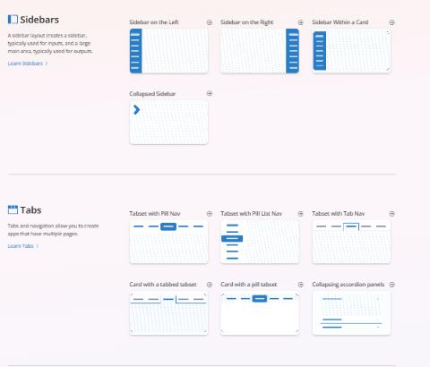
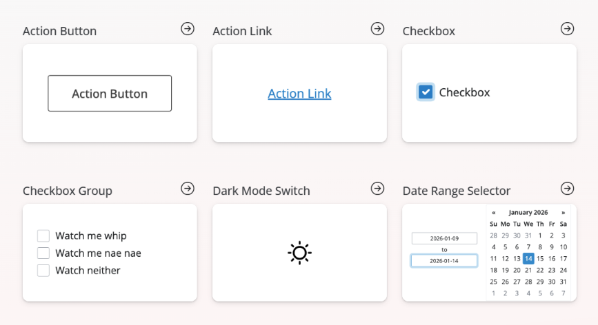

```{=html}
<style>
h1, h2, h3 {
color: #2f1a61;
}

.subtitle {
color: #291854;
}

.title {
color: #cc0065;
}

.pad-box {
padding: 1em;
}
</style>
```

```{r setup, include=FALSE}
knitr::opts_chunk$set(echo = TRUE)
```

------------------------------------------------------------------------

Welcome back! Today we will have a look at:

1.  How to build Shiny apps in R
2.  A short introduction to flexdashboards

------------------------------------------------------------------------

# Shiny Applications in R 💎

## What is Shiny?

Shiny is an R package that makes it easy to build interactive web applications (apps) straight from R. You need to install the package `shiny`:

```{r, eval = F}
#install.packages("shiny")
library(shiny)
library(bslib)
```

For a quick illustration of what you can do with Shiny head over to the interactive visualization tool for the [Freedom of Press Index](https://gallery.shinyapps.io/freedom-press-index/)

Throughout the lab we will use a running example to illustrate the different aspects of creating a shiny app. You can find it in `shiny_app.R`. It uses the `penguins` data from the `palmerpenguins` package and shows the distribution of a penguin measurement by species, together with a table of the data.

The app also uses the package `DT`, which makes interactive tables:

```{r, eval = F}
install.packages("DT")
```

------------------------------------------------------------------------

### Structure of a Shiny App

A Shiny app can be contained in a single R script. By convention the script is called `app.R` and lives in its own directory (for example, `newdir/`), so the app can be run with `shiny::runApp("newdir")`.

The file must have three core components:

1.  **A user interface object**: The (UI) object controls the layout and appearance of your app.

2.  **A server function**: The `server` function contains the instructions that your computer needs to build your app.

3.  **A call to the `shiny::shinyApp()` function**: The `shiny::shinyApp()` function creates Shiny app objects from an explicit UI/server pair.


------------------------------------------------------------------------

### Running a Shiny App

To create a Shiny app, save a script that contains the three components outlined above. It is recommended to save each app as `app.R` in its own directory.

You can run a Shiny app by giving the name of this directory to the function `shiny::runApp()`. For example, if your Shiny app is in a directory called `my_shiny_app`, run it with the following code:

```{r, eval = F}
shiny::runApp("my_shiny_app")
```

Our example is a single file called `shiny_app.R`. To run it, open the file in RStudio and click **Run App**, or run `shiny::runApp("shiny_app.R")`.

------------------------------------------------------------------------

## Layout functions / UI 🗺️

Shiny uses **layout functions** to provide the high-level visual structure of an app. In this lab we use the layout functions from the `bslib` package, which is installed with `shiny`. For example, `page_sidebar()` creates a page with a title, a sidebar and a main area, and automatically adjusts to the dimensions of the user's browser window. You can lay out the user interface of your app by placing elements in the `page_sidebar()` function.

Older Shiny code often uses `fluidPage()` with `sidebarLayout()` for the same kind of layout, so you will still see it in many examples online. It works the same way.

Layouts are created by a hierarchy of function calls, where the hierarchy in R matches the generated HTML. This means that you can get an intuitive idea of the app structure by assessing the layout. This is the `ui` of our running example:

``` r
page_sidebar(
  title = "Palmer penguins",
  fillable = FALSE, # let the page scroll so the table fits below the plot
  sidebar = sidebar(
    selectInput("measurement", "Measurement", choices = measurements)
  ),
  card(card_header("Distribution"), plotOutput("distribution")),
  card(card_header("Data"), DTOutput("penguin_table"))
)
```


We can guess what is going on by reading the function names. This code will generate a classic app design: a title bar at top, a sidebar (containing a `selectInput()`, which creates a dropdown menu) and a main area with two cards (containing the plot and the table).

:::{.alert-info .pad-box}
📝 **Note**

The ability to easily see hierarchy through indentation is one of the reasons it is a good idea to use a consistent style when building these apps.
:::

------------------------------------------------------------------------

While `page_sidebar()` creates a basic layout for your Shiny app, you can also choose from many different layouts. For example you can use `page_navbar()` to give your app a multi-page user interface that includes a navigation bar. Or you can use `layout_columns()` to place cards next to each other in a grid. If you'd like to learn more about these advanced options, have a look at the [Shiny layouts guide](https://shiny.posit.co/r/layouts/).

```{r, echo = F, out.width = "100%"}

```

Within the different layout functions you can also customize your app further by italicizing or making your font bold and even including html elements.

To learn more about how you can customize your UI see [here](https://shiny.posit.co/r/articles/build/html-tags/) and [here](https://shiny.posit.co/r/articles/build/tag-glossary/).

------------------------------------------------------------------------

## Widgets 🖱️

A widget is a web element that the users can interact with. In other words to make your app interactive, you need widgets. These provide a way for your users to send messages to the Shiny app, meaning that when a user changes the input in a widget, the value that is shown will change as well.

Shiny comes with a family of pre-built widgets, each created with a clearly named R function. For example, Shiny provides a function named `actionButton()` that creates an Action Button and a function named `sliderInput()` that creates a slider bar.

Check out the [Shiny components](https://shiny.posit.co/r/components/) page for an overview of standard widgets:

```{r, echo = F}

```

To add a widget to your app, you need to include a widget function in your `ui` object, usually inside `sidebar()`.

Each widget function requires several arguments. The first two arguments for each widget are:

1.  **A name for the widget**: The user will not see this name, but you can use it to access the widget's value. The name should be a character string.

2.  **A label**: This label will appear with the widget in your app. It should be a character string, but it can be an empty string `""`.

The remaining arguments vary from widget to widget, depending on what the widget needs to do its job. They include things like initial values, ranges, and increments. You can find the exact arguments needed by a widget on the widget function's help page, (e.g., `?selectInput`).

In our example app we have one widget, a `selectInput()` that lets the user choose which penguin measurement to plot:

```{r, eval=F}
measurements <- c(
  "Bill length (mm)" = "bill_length_mm",
  "Bill depth (mm)" = "bill_depth_mm",
  "Flipper length (mm)" = "flipper_length_mm",
  "Body mass (g)" = "body_mass_g"
)

page_sidebar(
  title = "Palmer penguins",
  sidebar = sidebar(
    selectInput("measurement", "Measurement", choices = measurements)
  ),
  ...
)
```

The names of `measurements` are shown in the dropdown, and the values are the column names. In the `server`, `input$measurement` holds the column name of the chosen measurement, for example `"body_mass_g"`.

------------------------------------------------------------------------

## Display Reactive Output

To give your Shiny App a feeling of live interactiveness you need to include a way to display reactive output. Reactive output automatically responds when your user selects an option in a widget.

There are two steps involved in making your widgets reactive:

1.  Add the relevant output function to your `ui` function.
2.  Provide R code to build the object in your `server` function.

### Step 1

Shiny provides a family of functions that turn R objects into output for your user interface. Each function creates a specific type of output.

In our running example we used `plotOutput()` for the plot and `DTOutput()` from the `DT` package for an interactive table:

```{r, eval = F}
ui <- page_sidebar(
  title = "Palmer penguins",
  sidebar = sidebar( ... ),
  card(card_header("Distribution"), plotOutput("distribution")),
  card(card_header("Data"), DTOutput("penguin_table"))
)
```

### Step 2

Placing a function in `ui` tells Shiny where to display your object. Next, you need to tell Shiny how to build the object.

We do this by providing the R code that builds the object in the `server` function. You do this by defining a new element for output within the `server` function. The element name should match the name of the reactive element that you created in the `ui`.

If you created a `textOutput("selected_var")` in your `ui`, `output$selected_var` in the `server` function matches this.

To illustrate this, let's look at our example, where we used `plotOutput("distribution")` and `DTOutput("penguin_table")`. In the `server` function we state:

```{r, eval = F}
server <- function(input, output) {
  output$distribution <- renderPlot({
    # .data[[ ]] picks the column whose name is stored in input$measurement
    ggplot(penguins_clean, aes(x = .data[[input$measurement]], fill = species)) +
      geom_density(alpha = 0.5, linewidth = 0.3)
  })

  output$penguin_table <- renderDT({
    datatable(penguins_clean, rownames = FALSE)
  })
}
```

:::{.alert-info .pad-box}
📝 **Note**

`reactive()` creates data that updates when an input changes. For example, this holds the penguins from the chosen islands:

```
selected <- reactive({
  penguins_clean |>
    filter(island %in% input$island)
})
```

When several outputs use `selected()`, the filter runs once for all of them. You call a reactive like a function, with brackets: `selected()`. You will need it in exercise 3.
:::


Every `*Output()` function in `ui` has a corresponding `render*()` function in server for building reactive widgets.

Each `render*` function takes a single argument: an R expression surrounded by braces, `{}`. The expression can be one simple line of code, or it can involve many lines of code.

------------------------------------------------------------------------

## Exercises
:::{.alert-info .pad-box}
Now it is your turn, adapt the Shiny app by:

1.  Putting the plot and the table in separate tabs.
    -   Hint: replace the two `card()`s with `navset_card_underline()` and one `nav_panel()` per output. Only the `ui` changes.
    -   Resources: [Shiny tabs](https://shiny.posit.co/r/layouts/tabs/), [bslib navsets](https://rstudio.github.io/bslib/reference/navset.html)
2.  Adding a choice between a density plot and a histogram.
    -   Hint: add `radioButtons()` to the sidebar. In `renderPlot()`, use `if`/`else` to add `geom_density()` or `geom_histogram()`, and change the y-axis label too.
    -   Resources: [radioButtons()](https://shiny.posit.co/r/reference/shiny/latest/radiobuttons.html), [geom_density()](https://ggplot2.tidyverse.org/reference/geom_density.html), [geom_histogram()](https://ggplot2.tidyverse.org/reference/geom_histogram.html)
3.  Adding a filter for the island.
    -   Hint: add a `checkboxGroupInput()` with the islands to the sidebar. Filter the data once in a `reactive()` and use it in both outputs.
    -   Resources: [checkboxGroupInput()](https://shiny.posit.co/r/reference/shiny/latest/checkboxgroupinput.html), [reactive()](https://shiny.posit.co/r/reference/shiny/latest/reactive.html), [Mastering Shiny: basic reactivity](https://mastering-shiny.org/basic-reactivity.html)

:::
------------------------------------------------------------------------

## More complex apps ⚙️

You can create more complex Shiny apps by loading R Scripts, packages, and data sets.

What you need to know is that:

-   The directory that `app.R` appears in will become the working directory of the Shiny app
-   Shiny will run code placed at the start of `app.R`, before the `server` function, only once during the life of the app.
-   Shiny will run code placed inside `server` function multiple times, which can slow down the app.

In our example, this is used to load the data, drop rows with missing values and define the list of measurements. This only needs to be done once. Within the `server` function we then build the plot for the selected measurement; obviously this needs to be repeated every time the input changes. This is why we placed that code within the `server` function.

------------------------------------------------------------------------

## Share your Apps

You can now build a useful Shiny app, but can you share it with others? This lesson will show you several ways to share your Shiny apps.

When it comes to sharing Shiny apps, you have two basic options:

1.  **Share your Shiny app as R scripts.** This is the simplest way to share an app, but it only works if your users have R on their own computer (and know how to use it). Users can use these scripts to launch the app from their own R session, just like you've been launching the apps so far in this tutorial. All they need is a copy of your app directory including the `app.R` script.

2.  **Share your Shiny app as a web page.** This is definitely the most user-friendly way to share a Shiny app. Your users can navigate to your app through the internet with a web browser. They will find your app fully rendered, up to date, and ready to go.

If you prefer the second option, I propose that you have a look at shinyapps.io. It's Posit's hosting service for Shiny apps. shinyapps.io lets you upload your app straight from your R session to a server hosted by Posit. You have complete control over your app including server administration tools. You can find out more about shinyapps.io by visiting [shinyapps.io](https://www.shinyapps.io/).


------------------------------------------------------------------------

# Dashboards with `flexdashboard`

The goal of flexdashboard is to make it easy to create interactive dashboards for R, using R Markdown. A flexdashboard can either be static (a standard web page) or dynamic (a Shiny interactive document). A wide variety of components can be included in flexdashboard layouts, for a full list see [the documentation](https://pkgs.rstudio.com/flexdashboard/articles/flexdashboard.html).

As with Shiny apps, we are going to be working with an example: `flexdashboard.Rmd`. It is the same app as `shiny_app.R`, built as a flexdashboard, so you can compare the two. You need to install the package `flexdashboard` to run it.

------------------------------------------------------------------------

## Flexdashboard in practice

The big difference to Shiny apps is that the flexdashboard Rmd file will take over the function used to define the layout of the dashboard/app. In other words, the entire Rmd, now plays the role of `page_sidebar()`.

So let's have a closer look at how you can structure a flexdashboard.

------------------------------------------------------------------------

## Columns and rows

Dashboards are divided into columns and rows, with output components delineated using level 3 markdown headers (`###`). By default, dashboards are laid out within a single column, with charts stacked vertically within a column and sized to fill available browser height.

If you want to change the dashboard to include multiple columns you can introduce the following (`--------------`).

If you want to change the dashboard to include multiple pages you can introduce the following (`=============`).

In the YAML header of the Rmd you can specify a number of additional properties:

-   `vertical_layout: scroll`
-   `orientation: rows`

Feeling overwhelmed? No need to come up with a fancy design all on your own. You can find a long list of templates [here](https://pkgs.rstudio.com/flexdashboard/articles/examples.html).

------------------------------------------------------------------------

## A note on shiny dashboards

To add Shiny components to a flexdashboard there are a few things that you need to remember.

1.  you need to add `runtime: shiny` to the options declared at the top of the document (YAML front matter).

2.  Add the `{.sidebar}` attribute to the first column of the dashboard to make it a host for Shiny input controls (note this step isn't strictly required, but many Shiny based dashboards will want to do this).

Overall, however, the same rules apply:

-   You should perform any expensive loading of data within the global chunk.
-   Input elements will go into the `{.sidebar}` column.
-   Outputs are represented within flexdashboard content panes

This is how these pieces look in our example, `flexdashboard.Rmd`.

The YAML header sets `runtime: shiny`, `vertical_layout: scroll` so the table fits below the plot, and a newer Bootstrap theme (`version: 5`) so it looks like the Shiny app:

```yaml
---
title: "Palmer penguins"
output:
  flexdashboard::flex_dashboard:
    orientation: columns
    vertical_layout: scroll
    theme:
      version: 5
runtime: shiny
---
```

The chunk named `global` loads the packages and prepares the data:

```{r, eval = F}
library(flexdashboard)
library(shiny)
library(dplyr)
library(ggplot2)
library(DT)
library(palmerpenguins)

# Drop rows with missing values
penguins_clean <- na.omit(penguins)

measurements <- c(
  "Bill length (mm)" = "bill_length_mm",
  "Bill depth (mm)" = "bill_depth_mm",
  "Flipper length (mm)" = "flipper_length_mm",
  "Body mass (g)" = "body_mass_g"
)
```

The first column, `Column {.sidebar}`, holds a chunk with the `selectInput()` widget:

```{r, eval = F}
selectInput("measurement", "Measurement", choices = measurements)
```

The second column, `Column`, has two `###` panels, `### Distribution` and `### Data`. Each one holds a chunk that calls a single `render*()` function, with no `plotOutput()` or `DTOutput()` needed:

```{r, eval = F}
# Plot
renderPlot({
  # .data[[ ]] picks the column whose name is stored in input$measurement
  ggplot(penguins_clean, aes(x = .data[[input$measurement]], fill = species)) +
    geom_density(alpha = 0.5, linewidth = 0.3) +
    labs(
      x = names(measurements)[measurements == input$measurement],
      y = "Density",
      fill = "Species"
    ) +
    theme_minimal(base_size = 14) +
    theme(legend.position = "bottom")
})
```

```{r, eval = F}
# Table
renderDT({
  datatable(penguins_clean, rownames = FALSE)
})
```

## Exercise
:::{.alert-info .pad-box}
Change `flexdashboard.Rmd` so that the plot and the table are shown in separate tabs, like in the first exercise.

-   Resources: [flexdashboard tabsets](https://pkgs.rstudio.com/flexdashboard/articles/using.html#tabsets)
:::

------------------------------------------------------------------------

# <b style="color:#2f1a61">Acknowledgements</b> {.unnumbered}

The Shiny tutorial leans heavily on RStudio's series of [Shiny tutorials](https://shiny.rstudio.com/tutorial/) and Posit's [Shiny tutorials](https://shiny.posit.co/r/getstarted/).

This script was drafted by [Tom Arendt](https://github.com/tom-arend) and [Lisa Oswald](https://lfoswald.github.io/), with contributions by [Steve Kerr](https://smkerr.github.io/), [Hiba Ahmad](https://github.com/hiba-ahmad), [Carmen Garro](https://github.com/cgarroca), [Sebastian Ramirez-Ruiz](https://seramirezruiz.github.io/), [Killian Conyngham](https://github.com/Killian-Conyngham), [Carol Sobral](https://github.com/cbsobral), [Linus Hagemann](https://linushagemann.de/) and [Laia Domenech Burin](https://github.com/ldmnch).
